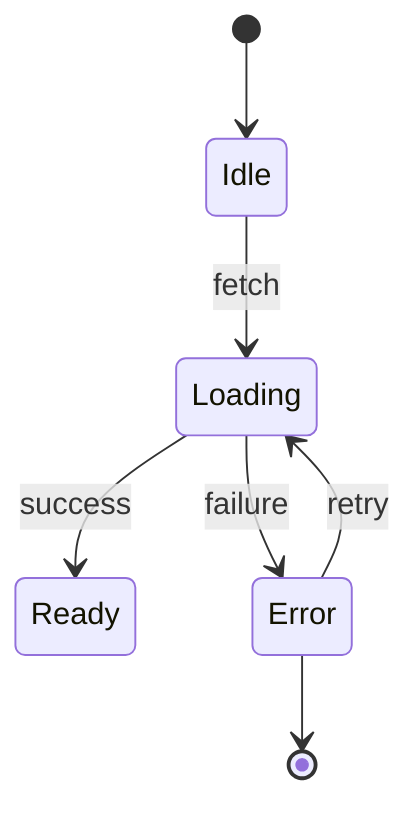

# Final report

Write this only after all safe atomic commits are done and verified. Use this structure exactly.

## 1. Audit summary and baseline status

- Pre-flight vs. post-audit test, lint, and typecheck status.
- Count of atomic commits applied vs. items held for review.

## 2. Applied atomic commits log

| Commit SHA | Phase | Files modified | Change and rationale |
| :--- | :--- | :--- | :--- |

## 3. Implicit state machine visuals (Phase 3)

For each machine: `file:line`, status (`Refactored in <sha>` or `Held for review`), and its Mermaid `stateDiagram-v2` with edge cases and impossible states marked.



## 4. Prioritized review backlog (Phases 1–4)

Group by priority: `P0` critical/bug/security, `P1` high-impact simplification/state, `P2` cleanup/DX/AX.

| Priority | Phase | Location (`file:line`) | Issue or challenged assumption | Impact (UX/DX/AX/Sec) | Recommended action |
| :--- | :--- | :--- | :--- | :--- | :--- |

## 5. Quick rollback reference

Give the exact commands to inspect and undo any single audit commit:

```sh
git log --oneline -n <count>
git revert <sha>
```
